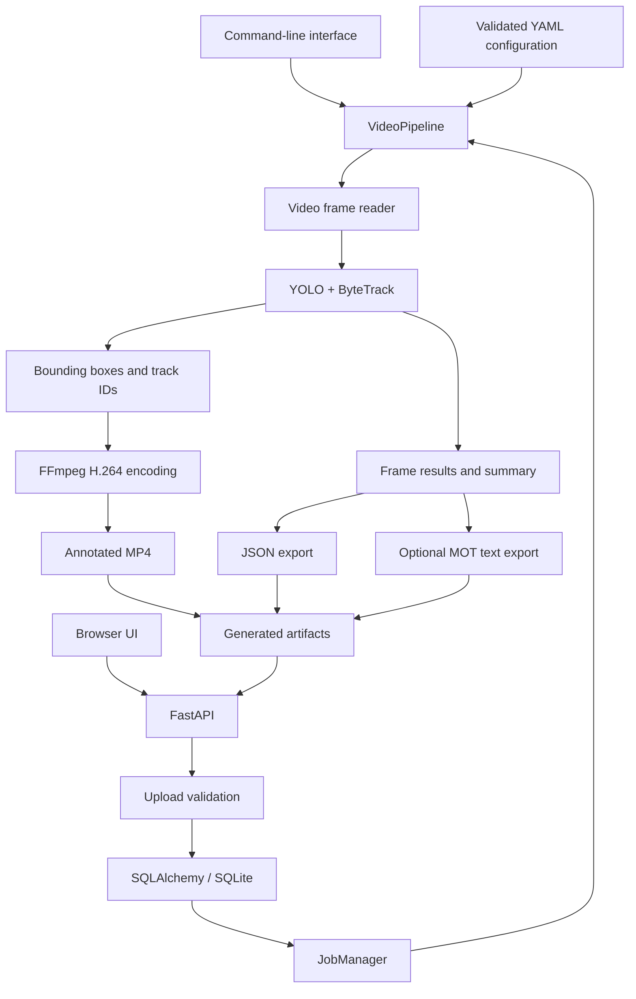

# TrackLab

[](https://github.com/abdullahdrm/tracklab/actions/workflows/ci.yml)
[](https://www.python.org/)
[](LICENSE)

**TrackLab is a video object-detection and multi-object-tracking application built around Ultralytics YOLO and ByteTrack.** It provides a reusable Python processing pipeline, a command-line interface, and a FastAPI web service for processing videos and retrieving annotated results.

The current release is **v0.1.1**. Development so far has focused on building a reliable end-to-end application with configurable inference, testable components, API integration, and containerized deployment.

## Overview

TrackLab processes a video frame by frame, detects objects, maintains track identities across consecutive frames, and exports the resulting video and structured data.

### Current capabilities

- **Object detection:** YOLO inference with configurable model, confidence threshold, IoU threshold, input resolution, and class selection.
- **Multi-object tracking:** ByteTrack integration with persistent track identities across consecutive frames.
- **Video processing:** Frame reading, bounding-box visualization, and H.264 MP4 output.
- **Structured results:** JSON output containing video metadata, summary statistics, processing configuration, and optional per-frame tracking results.
- **MOT export:** Optional text output in MOTChallenge-style format.
- **Web application:** Browser-based video upload and result retrieval through FastAPI.
- **Job management:** Persistent job status and summary records backed by SQLAlchemy and SQLite.
- **Input validation:** Checks for supported file types, upload size, video readability, and duration.
- **Deployment and testing:** Docker Compose support, unit tests, API integration tests, and GitHub Actions CI.

## Architecture

The command-line interface and web application share the same video-processing pipeline. The API adds upload validation, job persistence, background execution, and endpoints for retrieving generated artifacts.



### Technology stack

| Area | Technologies |
|---|---|
| Detection | Ultralytics YOLO |
| Multi-object tracking | ByteTrack |
| Processing | Python, NumPy |
| Video I/O and encoding | OpenCV, FFmpeg |
| API | FastAPI, Uvicorn |
| Data validation | Pydantic |
| Persistence | SQLAlchemy, SQLite |
| Configuration | YAML |
| Testing and code quality | pytest, Ruff |
| Deployment | Docker, Docker Compose, GitHub Actions |

## Quick start

### Requirements

- Python 3.12
- FFmpeg
- YOLO11n model weights
- Docker Desktop or another Docker Engine, if using container deployment

### 1. Clone and install

```bash
git clone https://github.com/abdullahdrm/tracklab.git
cd tracklab

python3.12 -m venv .venv
source .venv/bin/activate

python -m pip install --upgrade pip
python -m pip install -e ".[dev]"
```

Install FFmpeg if it is not already available.

**macOS:**

```bash
brew install ffmpeg
```

**Ubuntu/Debian:**

```bash
sudo apt-get update
sudo apt-get install --no-install-recommends -y ffmpeg
```

### 2. Download the model weights

Model weights are not committed to the repository. Download the official YOLO11n asset into the expected location:

```bash
mkdir -p models
curl -fL \
  https://github.com/ultralytics/assets/releases/download/v8.3.0/yolo11n.pt \
  -o models/yolo11n.pt
```

Review the applicable Ultralytics licensing terms before redistributing model weights or deploying a solution that uses them.

### 3. Process a video

Run the CLI from the repository root, replacing the input path with a video on your machine:

```bash
python scripts/run_video.py /path/to/video.mp4 \
  --config configs/pipeline.yaml \
  --output-dir outputs/demo
```

Depending on the configured output settings, the pipeline can generate:

| Artifact | Description |
|---|---|
| `*_tracked.mp4` | Annotated H.264 video with bounding boxes and track IDs |
| `*_result.json` | Video metadata, summary, configuration, and optionally per-frame results |
| `*_mot.txt` | Optional MOT-format tracking output |

### 4. Start the API

```bash
uvicorn tracklab.api.main:app --host 127.0.0.1 --port 8000
```

Open these endpoints in your browser:

- **Web interface:** <http://127.0.0.1:8000/>
- **Interactive API documentation:** <http://127.0.0.1:8000/docs>
- **Health check:** <http://127.0.0.1:8000/health>

### API endpoints

| Method | Endpoint | Purpose |
|---|---|---|
| `GET` | `/health` | Service health check |
| `POST` | `/jobs` | Upload a video and queue processing |
| `GET` | `/jobs/{job_id}` | Retrieve job status and summary |
| `GET` | `/jobs/{job_id}/preview` | Play the annotated video in the browser |
| `GET` | `/jobs/{job_id}/video` | Download the annotated MP4 |
| `GET` | `/jobs/{job_id}/result` | Download the JSON results |

The default limits are **500 MiB per upload** and **600 seconds per video**. Configure them using `TRACKLAB_MAX_UPLOAD_BYTES` and `TRACKLAB_MAX_VIDEO_DURATION_SECONDS`.

Uploaded source videos are temporary and are deleted after successful or failed processing. Uploads rejected during validation are also removed. Generated result artifacts remain in the output directory until manually deleted.

## Docker deployment

Ensure that `models/yolo11n.pt` exists. From the repository root, run:

```bash
export TRACKLAB_UID="$(id -u)"
export TRACKLAB_GID="$(id -g)"

docker compose -f docker/docker-compose.yml up --build
```

The service binds to localhost on port `8000`. Once the container is healthy, open <http://127.0.0.1:8000/>.

Stop the service with:

```bash
docker compose -f docker/docker-compose.yml down
```

### Persistent directories

| Directory | Purpose |
|---|---|
| `data/` | SQLite database and temporary uploads |
| `outputs/` | Generated video and JSON artifacts |
| `models/` | Model weights, mounted read-only inside the container |

The container uses CPU inference. Apple MPS acceleration is available when running locally on supported macOS hardware, but is not available inside this Linux container.

## Configuration

The main configuration file is `configs/pipeline.yaml`. It references component YAML files relative to its own directory.

| Configuration file | Purpose |
|---|---|
| `configs/detector.yaml` | YOLO model path, input resolution, confidence and IoU thresholds, classes, and device |
| `configs/bytetrack.yaml` | ByteTrack thresholds, track buffer, and matching settings |
| `configs/pipeline.yaml` | Component configuration references and output options |
| `configs/preprocessing.yaml` | Configuration for planned image-preprocessing modes |
| `configs/analytics.yaml` | Configuration for planned line-counting and trajectory analytics |

**Implementation status:** In v0.1.1, detector, tracker, and output settings are consumed by the processing pipeline. The preprocessing and analytics configurations are scaffolding only; gamma correction, CLAHE, denoising, line counting, and trajectory analytics are not yet connected to the runtime processing loop.

## Tests and code quality

Install the development dependencies, then run:

```bash
python -m pytest -q
ruff check src/tracklab scripts tests
ruff format --check src/tracklab scripts tests
```

The project includes unit and API integration tests. GitHub Actions runs lint, formatting, and test checks on pushes and pull requests targeting `master`.

## Scope and limitations

TrackLab is a local portfolio and demonstration application, not a hardened public multi-user service.

- Jobs run through FastAPI background tasks rather than a durable worker queue.
- Interrupted jobs are not automatically resumed after a process or container restart.
- Authentication, user quotas, and production-grade observability are not implemented.
- Quantitative MOT benchmark evaluation and preprocessing ablations are not yet completed.
- Preprocessing, line counting, and trajectory analytics are planned extensions, not active features in v0.1.1.

## Roadmap

The next development stage focuses on establishing a reproducible evaluation workflow before attempting model or preprocessing improvements.

1. **Dataset preparation:** Add a MOT17 reader and deterministic tuning/hold-out split manifests.
2. **Evaluation integration:** Integrate TrackEval and verify the evaluation bridge with a perfect-prediction sanity test.
3. **Baseline measurement:** Evaluate YOLO + ByteTrack on designated tuning sequences.
4. **Preprocessing experiments:** Implement and compare gamma correction, CLAHE, and selected denoising options.
5. **Controlled ablations:** Measure the effect of preprocessing and synthetic image degradations against the established baseline.

These are planned milestones, not completed results. Benchmark metrics and performance claims will be added after the corresponding experiments have been run and verified.

## License

TrackLab source code is released under [AGPL-3.0-only](LICENSE). Third-party dependencies, model weights, and datasets may be subject to separate licensing terms.
