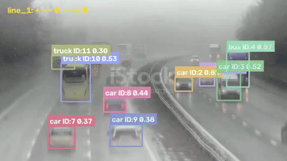
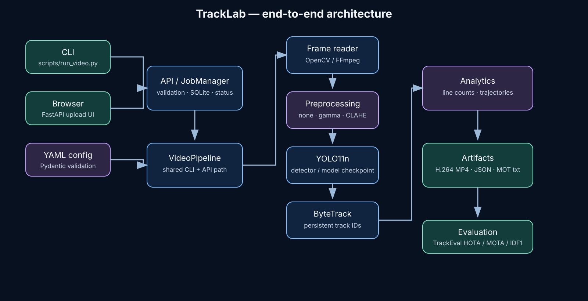
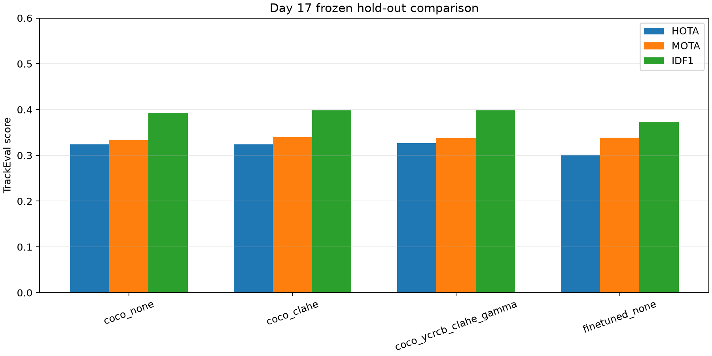
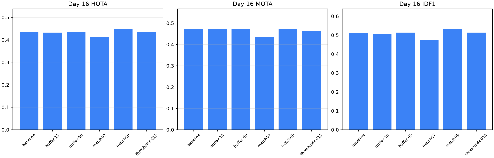
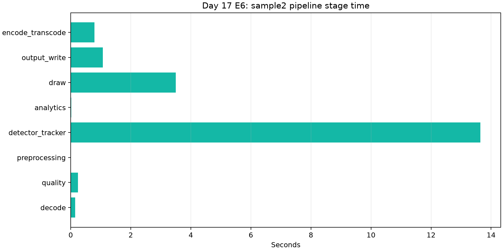

# TrackLab

[](https://github.com/abdullahdrm/tracklab/actions/workflows/ci.yml)
[](https://www.python.org/)
[](LICENSE)

TrackLab is a configurable video object-detection, multi-object-tracking and
analytics pipeline built with Ultralytics YOLO11n, ByteTrack, OpenCV, FFmpeg and
FastAPI. It produces annotated H.264 video, structured JSON, optional
MOTChallenge output, directional line counts and per-track trajectories.

The default detector is the COCO-pretrained YOLO11n checkpoint. The BDD100K
fine-tuned checkpoint is retained as an explicit comparison because it reduced
MOT17 tracking performance.



The full locally generated demo is 74.2 seconds at 960×540:
`outputs/final_demo/tracklab_final_demo.mp4`. It is not committed because its
source clips are local data with separate licensing terms.

## Architecture



CLI and browser requests share `VideoPipeline`. The API adds upload validation,
SQLite-backed job state and artifact download endpoints. Configuration is
validated with Pydantic and component YAML files are resolved relative to the
selected pipeline config.

## Features

- YOLO detection with configurable weights, resolution, confidence, IoU and classes.
- ByteTrack identity tracking with explicit threshold and buffer settings.
- Optional gamma, CLAHE, denoise, chained and color-space preprocessing.
- Directional line-crossing counts and smoothed trajectories.
- Sampled brightness, contrast, sharpness and noise-proxy quality metrics.
- H.264 MP4, JSON and optional MOTChallenge text output.
- FastAPI upload UI with persistent job status and health endpoint.
- Docker Compose deployment and GitHub Actions lint/format/test CI.
- MOT17 TrackEval evaluation, frozen hold-out protocol and reproducible reports.

## Quick start

Requirements: Python 3.12, FFmpeg and YOLO11n weights. Model weights and
datasets are intentionally not committed.

```bash
git clone https://github.com/abdullahdrm/tracklab.git
cd tracklab
python3.12 -m venv .venv
source .venv/bin/activate
python -m pip install --upgrade pip
python -m pip install -e ".[dev,evaluation]"
mkdir -p models
curl -fL \
  https://github.com/ultralytics/assets/releases/download/v8.3.0/yolo11n.pt \
  -o models/yolo11n.pt
```

Process a video:

```bash
python scripts/run_video.py /path/to/video.mp4 \
  --config configs/pipeline.yaml \
  --output-dir outputs/demo
```

The default configuration writes `*_tracked.mp4` and `*_result.json`.
Enable `save_mot_txt` in the output config for a MOTChallenge text file.

Start the API locally:

```bash
uvicorn tracklab.api.main:app --host 127.0.0.1 --port 8000
```

Open <http://127.0.0.1:8000/>. Main endpoints:

| Method | Endpoint | Purpose |
|---|---|---|
| GET | `/health` | Service health |
| POST | `/jobs` | Upload and queue a video |
| GET | `/jobs/{job_id}` | Job status and summary |
| GET | `/jobs/{job_id}/preview` | Browser video preview |
| GET | `/jobs/{job_id}/video` | Download MP4 |
| GET | `/jobs/{job_id}/result` | Download JSON |

The default limits are 500 MiB per upload and 600 seconds per video. Uploaded
source files are removed after successful or failed processing; generated
artifacts remain until manually deleted.

## Docker

With a Docker Engine running and `models/yolo11n.pt` available:

```bash
export TRACKLAB_UID="$(id -u)"
export TRACKLAB_GID="$(id -g)"
docker compose -f docker/docker-compose.yml up --build
```

The service binds to `127.0.0.1:8000`. Stop it with:

```bash
docker compose -f docker/docker-compose.yml down
```

The container uses CPU inference. Local macOS runs can use MPS when the
detector config selects `device: auto`.

## Measured results

Results use the pinned Ultralytics `8.4.175` runtime and TrackEval
MOTChallenge metrics. Combined rows are joint evaluations, not arithmetic
means of sequence rows.

### Tuning baseline and fine-tuning

| Condition | Split | HOTA | MOTA | IDF1 | IDSW |
|---|---|---:|---:|---:|---:|
| COCO YOLO11n + ByteTrack | tuning 04/05/09/11 | 0.4351 | 0.4725 | 0.5111 | 371 |
| BDD100K fine-tuned + ByteTrack | tuning 04/05/09/11 | 0.3316 | — | 0.3790 | 476 |
| COCO YOLO11n + ByteTrack | hold-out 02/10/13 | 0.3237 | 0.3334 | 0.3931 | 354 |
| BDD100K fine-tuned + ByteTrack | hold-out 02/10/13 | 0.3011 | 0.3389 | 0.3728 | 667 |

Fine-tuning is technically valid and reproducible, but does not improve the
MOT17 objective. See [`reports/fine_tuning_root_cause.md`](reports/fine_tuning_root_cause.md),
[`reports/day17_final_evaluation.md`](reports/day17_final_evaluation.md), and
[`reports/error_analysis.md`](reports/error_analysis.md).



### Tracker ablation

Day 16 tested a small, tuning-only ByteTrack search. `match_thresh=0.9` gave
the best combined HOTA (0.4483) and IDF1 (0.5324), but regressed on MOT17-05;
the balanced baseline was therefore retained for the final evaluation.



### Runtime

On local `sample2.mp4`, 505 frames were processed in 19.424 seconds with an
effective 25.999 FPS. Detector + tracker consumed 13.644 seconds; drawing
consumed 3.497 seconds; H.264 transcode consumed 0.789 seconds.



## Reproducibility

After preparing MOT17 and placing `models/yolo11n.pt` in the expected path:

```bash
# Tuning baseline
python scripts/evaluate_mot.py --split tuning --detectors yolo

# Day 16 tracker search, tuning only
python scripts/run_tracker_ablation.py \
  --output-root outputs/mot17/tracker_ablation_day16

# Day 17 frozen hold-out
python scripts/run_final_holdout.py \
  --protocol configs/day17_final_protocol.yaml
```

The hold-out runner rejects tuning sequences and refuses to overwrite an
existing summary unless explicitly asked to reuse it. Do not change the frozen
protocol after inspecting results.

Run quality gates:

```bash
python -m pytest -q
ruff check src/tracklab evaluation scripts tests
ruff format --check src/tracklab evaluation scripts tests
```

GitHub Actions runs the same lint, format and test checks for pushes and pull
requests targeting `master`.

## Repository guide

| Path | Purpose |
|---|---|
| `src/tracklab/` | Pipeline, API, tracking, preprocessing and analytics |
| `configs/` | Detector, tracker, preprocessing, analytics and eval settings |
| `evaluation/` | MOT17, TrackEval, ablation and frozen hold-out runners |
| `training/` | BDD100K conversion and fine-tuning entry points |
| `reports/` | Audited experiment results and limitations |
| `MODEL_CARD.md` | Model provenance, intended use and risks |
| `DATA_LICENSES.md` | Dataset and third-party attribution notes |
| `docs/TASKS.md` | Day-by-day project acceptance checklist |

## Limitations

- MOT17 evaluation measures pedestrian tracking; it does not validate vehicle
  classification or real fog/rain robustness.
- The BDD100K fine-tuned checkpoint shows domain/calibration and track-continuity
  degradation on MOT17. It is not the default model.
- The E5 manual count is a bounded one-sequence audit, not a general human-count
  accuracy benchmark.
- Docker image build and `/health` smoke testing run in GitHub Actions; local
  Docker builds still require a running Docker daemon.
- The FastAPI service is a local demo: authentication, quotas, durable worker
  queues and production observability are not implemented.

## License and attribution

TrackLab source code is released under [AGPL-3.0-only](LICENSE). Ultralytics
YOLO, MOT17, BDD100K, TrackEval and the local sample videos have separate terms;
see [`DATA_LICENSES.md`](DATA_LICENSES.md) before redistribution or commercial
use. Model and dataset files are excluded from Git.
