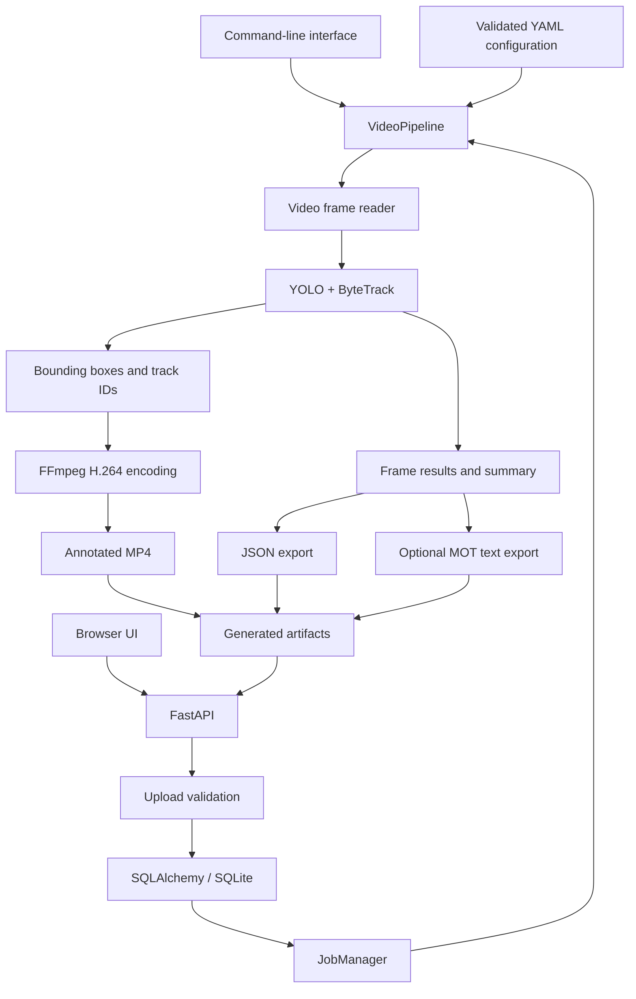

# TrackLab

[](https://github.com/abdullahdrm/tracklab/actions/workflows/ci.yml)
[](https://www.python.org/)
[](LICENSE)

**TrackLab is a video object-detection and multi-object-tracking application built around Ultralytics YOLO and ByteTrack.** It provides a reusable Python processing pipeline, directional line counting and trajectory analytics, a command-line interface, and a FastAPI web service for processing videos and retrieving annotated results.

The current release is **v0.1.1**. Development so far has focused on building a reliable end-to-end application with configurable inference, testable components, API integration, and containerized deployment.

## Overview

TrackLab processes a video frame by frame, detects objects, maintains track identities across consecutive frames, and exports the resulting video and structured data.

### Current capabilities

- **Object detection:** YOLO inference with configurable model, confidence threshold, IoU threshold, input resolution, and class selection.
- **Multi-object tracking:** ByteTrack integration with persistent track identities across consecutive frames.
- **Video processing:** Frame reading, bounding-box visualization, and H.264 MP4 output.
- **Structured results:** JSON output containing video metadata, summary statistics, processing configuration, and optional per-frame tracking results.
- **Frame-quality report:** Sampled brightness, contrast, sharpness, and a robust noise proxy are included under `summary.quality`; sampling frequency is configurable.
- **Classical preprocessing:** Optional `none`, gamma, CLAHE, denoise, and chained modes can be selected; preprocessing is disabled by default.
- **MOT export:** Optional text output in MOTChallenge-style format.
- **Video analytics:** Directional line-crossing counts and smoothed per-track trajectories are included in the JSON summary and annotated video when configured.
- **Web application:** Browser-based video upload and result retrieval through FastAPI.
- **Job management:** Persistent job status and summary records backed by SQLAlchemy and SQLite.
- **Input validation:** Checks for supported file types, upload size, video readability, and duration.
- **Deployment and testing:** Docker Compose support, unit tests, API integration tests, and GitHub Actions CI.

## Architecture

The command-line interface and web application share the same video-processing pipeline. The API adds upload validation, job persistence, background execution, and endpoints for retrieving generated artifacts.



### Technology stack

| Area | Technologies |
|---|---|
| Detection | Ultralytics YOLO |
| Multi-object tracking | ByteTrack |
| Processing | Python, NumPy |
| Video I/O and encoding | OpenCV, FFmpeg |
| API | FastAPI, Uvicorn |
| Data validation | Pydantic |
| Persistence | SQLAlchemy, SQLite |
| Configuration | YAML |
| Testing and code quality | pytest, Ruff |
| Deployment | Docker, Docker Compose, GitHub Actions |

## Quick start

### Requirements

- Python 3.12
- FFmpeg
- YOLO11n model weights
- Docker Desktop or another Docker Engine, if using container deployment

### 1. Clone and install

```bash
git clone https://github.com/abdullahdrm/tracklab.git
cd tracklab

python3.12 -m venv .venv
source .venv/bin/activate

python -m pip install --upgrade pip
python -m pip install -e ".[dev]"
```

Install FFmpeg if it is not already available.

**macOS:**

```bash
brew install ffmpeg
```

**Ubuntu/Debian:**

```bash
sudo apt-get update
sudo apt-get install --no-install-recommends -y ffmpeg
```

### 2. Download the model weights

Model weights are not committed to the repository. Download the official YOLO11n asset into the expected location:

```bash
mkdir -p models
curl -fL \
  https://github.com/ultralytics/assets/releases/download/v8.3.0/yolo11n.pt \
  -o models/yolo11n.pt
```

Review the applicable Ultralytics licensing terms before redistributing model weights or deploying a solution that uses them.

### 3. Process a video

Run the CLI from the repository root, replacing the input path with a video on your machine:

```bash
python scripts/run_video.py /path/to/video.mp4 \
  --config configs/pipeline.yaml \
  --output-dir outputs/demo
```

Depending on the configured output settings, the pipeline can generate:

| Artifact | Description |
|---|---|
| `*_tracked.mp4` | Annotated H.264 video with bounding boxes and track IDs |
| `*_result.json` | Video metadata, summary, configuration, and optionally per-frame results |
| `*_mot.txt` | Optional MOT-format tracking output |

### 4. Start the API

```bash
uvicorn tracklab.api.main:app --host 127.0.0.1 --port 8000
```

Open these endpoints in your browser:

- **Web interface:** <http://127.0.0.1:8000/>
- **Interactive API documentation:** <http://127.0.0.1:8000/docs>
- **Health check:** <http://127.0.0.1:8000/health>

### API endpoints

| Method | Endpoint | Purpose |
|---|---|---|
| `GET` | `/health` | Service health check |
| `POST` | `/jobs` | Upload a video and queue processing |
| `GET` | `/jobs/{job_id}` | Retrieve job status and summary |
| `GET` | `/jobs/{job_id}/preview` | Play the annotated video in the browser |
| `GET` | `/jobs/{job_id}/video` | Download the annotated MP4 |
| `GET` | `/jobs/{job_id}/result` | Download the JSON results |

The default limits are **500 MiB per upload** and **600 seconds per video**. Configure them using `TRACKLAB_MAX_UPLOAD_BYTES` and `TRACKLAB_MAX_VIDEO_DURATION_SECONDS`.

Uploaded source videos are temporary and are deleted after successful or failed processing. Uploads rejected during validation are also removed. Generated result artifacts remain in the output directory until manually deleted.

## Docker deployment

Ensure that `models/yolo11n.pt` exists. From the repository root, run:

```bash
export TRACKLAB_UID="$(id -u)"
export TRACKLAB_GID="$(id -g)"

docker compose -f docker/docker-compose.yml up --build
```

The service binds to localhost on port `8000`. Once the container is healthy, open <http://127.0.0.1:8000/>.

Stop the service with:

```bash
docker compose -f docker/docker-compose.yml down
```

### Persistent directories

| Directory | Purpose |
|---|---|
| `data/` | SQLite database and temporary uploads |
| `outputs/` | Generated video and JSON artifacts |
| `models/` | Model weights, mounted read-only inside the container |

The container uses CPU inference. Apple MPS acceleration is available when running locally on supported macOS hardware, but is not available inside this Linux container.

## Configuration

The main configuration file is `configs/pipeline.yaml`. It references component YAML files relative to its own directory.

| Configuration file | Purpose |
|---|---|
| `configs/detector.yaml` | YOLO model path, input resolution, confidence and IoU thresholds, classes, and device |
| `configs/bytetrack.yaml` | ByteTrack thresholds, track buffer, and matching settings |
| `configs/pipeline.yaml` | Component configuration references and output options |
| `configs/preprocessing.yaml` | Select `none`, gamma, CLAHE, denoise, or a configured preprocessing chain |
| `configs/analytics.yaml` | Line-counting and trajectory settings |

**Implementation status:** The latest tagged release is v0.1.1. In the current development tree, detector, tracker, quality sampling, output settings, configured classical preprocessing, line counting, and trajectory analytics are consumed by the processing pipeline. Preprocessing defaults to `mode: none`; when enabled, it modifies only the frame passed to the tracker. Quality metrics and output visualization use the original frame.

## Fine-tuning result and default model

The BDD100K six-class fine-tuning experiment completed successfully, but it
did not improve the current MOT17 tracking objective. On the four tuning
sequences, HOTA decreased from **0.4351** with the COCO-pretrained model to
**0.3316** after fine-tuning; IDF1 decreased from **0.5111** to **0.3790** and
ID switches increased from **371** to **476**. Raw detector diagnostics also
showed lower precision and recall before ByteTrack was applied.

The COCO-pretrained model therefore remains the default in
`configs/pipeline.yaml`. The fine-tuned model is retained for comparison and
can be selected explicitly with `configs/pipeline_finetuned.yaml`. The full
investigation and uncertainty boundaries are documented in
[`reports/fine_tuning_root_cause.md`](reports/fine_tuning_root_cause.md).

## MOT17 evaluation: initial tuning baseline

The first quantitative baseline uses only MOT17 tuning sequences 04, 05, 09, and 11. Hold-out sequences 02, 10, and 13 are reserved for the final evaluation on Day 17.

The initial YOLO configuration in `configs/eval.yaml` uses YOLO11n with `imgsz=960`, confidence `0.10`, IoU `0.7`, and automatic device selection. The evaluation focuses on the person class and uses ByteTrack.

The FRCNN rows use the precomputed detection files supplied with the corresponding MOT17 FRCNN sequences. They do **not** represent a Faster R-CNN model run by TrackLab. Treat these rows as a reference for comparing detection sources with ByteTrack, not as a strictly controlled model-versus-model experiment.

| Sequence | Detection source + tracker | HOTA | DetA | AssA | LocA | MOTA | IDSW | IDF1 | IDP | IDR |
|---|---|---:|---:|---:|---:|---:|---:|---:|---:|---:|
| MOT17-04 | MOT17 FRCNN detections + ByteTrack | 0.5306 | 0.4838 | 0.5832 | 0.9036 | 0.5424 | 43 | 0.6223 | 0.8821 | 0.4807 |
| MOT17-04 | YOLO11n + ByteTrack | 0.4277 | 0.4143 | 0.4472 | 0.8313 | 0.4576 | 142 | 0.4998 | 0.6881 | 0.3924 |
| MOT17-05 | MOT17 FRCNN detections + ByteTrack | 0.4293 | 0.4043 | 0.4567 | 0.8429 | 0.4840 | 57 | 0.5455 | 0.8052 | 0.4125 |
| MOT17-05 | YOLO11n + ByteTrack | 0.4034 | 0.4182 | 0.3929 | 0.7703 | 0.4292 | 130 | 0.5439 | 0.6281 | 0.4795 |
| MOT17-09 | MOT17 FRCNN detections + ByteTrack | 0.4811 | 0.4870 | 0.4755 | 0.8993 | 0.5454 | 17 | 0.5850 | 0.8171 | 0.4556 |
| MOT17-09 | YOLO11n + ByteTrack | 0.4325 | 0.5138 | 0.3670 | 0.8181 | 0.5775 | 60 | 0.5078 | 0.5538 | 0.4689 |
| MOT17-11 | MOT17 FRCNN detections + ByteTrack | 0.5422 | 0.5256 | 0.5601 | 0.9058 | 0.5719 | 44 | 0.6105 | 0.8077 | 0.4907 |
| MOT17-11 | YOLO11n + ByteTrack | 0.4874 | 0.5067 | 0.4730 | 0.8370 | 0.5197 | 39 | 0.5395 | 0.6213 | 0.4768 |
| Tuning combined | MOT17 FRCNN detections + ByteTrack | 0.5195 | 0.4813 | 0.5621 | 0.8982 | 0.5408 | 161 | 0.6103 | 0.8587 | 0.4733 |
| Tuning combined | YOLO11n + ByteTrack | 0.4351 | 0.4353 | 0.4408 | 0.8246 | 0.4725 | 371 | 0.5111 | 0.6563 | 0.4185 |

The combined rows are TrackEval's joint evaluation over all four tuning sequences, not the arithmetic mean of the four individual rows. Results vary by sequence; for example, YOLO has a higher MOTA on MOT17-09 in this initial run.

### Confidence and input-resolution sweep

A 12-configuration sweep was run on tuning sequences 04, 05, 09, and 11. The selected general-purpose baseline remains `conf=0.10`, `imgsz=960`: it provides the highest MOTA among these settings, fewer ID switches than the high-resolution candidates, and lower runtime than `imgsz=1280`.

| Confidence | imgsz | HOTA | MOTA | IDF1 | IDSW | Total sequence time |
|---:|---:|---:|---:|---:|---:|---:|
| 0.10 | 640 | 0.3951 | 0.3767 | 0.4598 | 300 | 51.7 s |
| 0.15 | 640 | 0.3922 | 0.3705 | 0.4534 | 301 | 58.3 s |
| 0.20 | 640 | 0.3878 | 0.3642 | 0.4457 | 319 | 52.6 s |
| 0.10 | 736 | 0.4267 | 0.4214 | 0.5103 | 307 | 53.2 s |
| 0.15 | 736 | 0.4144 | 0.4127 | 0.4880 | 309 | 62.4 s |
| 0.20 | 736 | 0.4116 | 0.4059 | 0.4898 | 321 | 65.8 s |
| 0.10 | 960 | 0.4351 | **0.4725** | 0.5111 | 371 | 72.7 s |
| 0.15 | 960 | 0.4352 | 0.4687 | 0.5117 | 362 | 76.9 s |
| 0.20 | 960 | 0.4336 | 0.4649 | 0.5083 | 364 | 74.3 s |
| 0.10 | 1280 | 0.4554 | 0.4627 | 0.5253 | 445 | 79.9 s |
| 0.15 | 1280 | **0.4566** | 0.4662 | **0.5257** | 463 | 79.7 s |
| 0.20 | 1280 | 0.4544 | 0.4697 | 0.5249 | 470 | 80.7 s |

The `0.15 / 1280` setting reaches the highest combined HOTA and IDF1 but adds 92 ID switches versus the selected baseline. It also regresses substantially on MOT17-05: HOTA falls from `0.4034` to `0.3621`, MOTA from `0.4292` to `0.2514`, and IDF1 from `0.5439` to `0.4452`. The combined metrics therefore do not justify selecting it as the general-purpose baseline. The `0.15 / 960` HOTA gain over the current baseline is negligible (`0.00008`) and comes with lower MOTA and longer runtime.

The figures are joint TrackEval results for the four tuning sequences, not arithmetic means of per-sequence metrics. The old incomplete `imgsz=720` run was excluded; the intended size was changed to `736` after Ultralytics reported stride-32 rounding. Hold-out sequences 02, 10, and 13 were not evaluated.

To rerun the tuning evaluation from the repository root, prepare the MOT17 dataset and make sure `models/yolo11n.pt` is available, then run:

```bash
python scripts/evaluate_mot.py --split tuning --detectors both
```

## Tests and code quality
Install the development dependencies, then run:

```bash
python -m pytest -q
ruff check src/tracklab scripts evaluation tests
ruff format --check src/tracklab scripts evaluation tests
```

The project includes unit and API integration tests. GitHub Actions runs lint, formatting, and test checks on pushes and pull requests targeting `master`.

## Scope and limitations

TrackLab is a local portfolio and demonstration application, not a hardened public multi-user service.

- Jobs run through FastAPI background tasks rather than a durable worker queue.
- Interrupted jobs are not automatically resumed after a process or container restart.
- Authentication, user quotas, and production-grade observability are not implemented.
- Initial MOT17 baseline and confidence/input-resolution selection are documented; preprocessing ablations remain pending. Hold-out sequences (02, 10, 13) are reserved for Day 17.
- Classical preprocessing and sampled frame-quality reporting are implemented in the current development tree, but preprocessing defaults to `none`. Fine-tuning is retained as a documented comparison, not the default detector; hold-out evaluation remains reserved for Day 17.

## Roadmap

The MOT17 evaluation infrastructure, initial baseline, confidence/input-resolution selection, quality reporting, and preprocessing implementation are complete. Quantitative preprocessing ablations and downstream application analytics remain open.

1. **[x] Dataset preparation:** MOT17 reader and deterministic tuning/hold-out split manifests.
2. **[x] Evaluation integration:** TrackEval bridge and perfect-prediction sanity test.
3. **[x] Baseline stabilization:** Measured `conf`/`imgsz` settings on tuning sequences and selected `conf=0.10`, `imgsz=960` as the balanced starting configuration.
4. **[x] Preprocessing implementation:** Implement gamma correction, CLAHE, denoising, a factory, and pipeline integration with `none` as the default.
5. **[x] Controlled ablations:** Measure preprocessing and synthetic image degradations against the established baseline.

Only tuning sequences 04, 05, 09, and 11 have been used for the baseline and parameter sweep. Hold-out sequences 02, 10, and 13 remain reserved for the final evaluation on Day 17.

## License

TrackLab source code is released under [AGPL-3.0-only](LICENSE). Third-party dependencies, model weights, and datasets may be subject to separate licensing terms.

<!-- TRACKLAB_DAY10_ABLATIONS -->
## Week 2 / Day 10 — Preprocessing ablations

The MOT17 tuning-only evaluation compares the unprocessed YOLO11n + ByteTrack baseline against classical preprocessing, controlled synthetic degradations, fixed method chains, and LAB/HSV/YCrCb channel variants. Real-image E2 and synthetic E2b results are documented separately in [`reports/day10_ablation_results.md`](reports/day10_ablation_results.md).

Selected real-image results on the four tuning sequences: baseline HOTA **0.4351** / IDF1 **0.5111**; CLAHE HOTA **0.4512** / IDF1 **0.5373**; gamma → LAB CLAHE HOTA **0.4542** / IDF1 **0.5354**. The exploratory YCrCb CLAHE → Gamma variant reached HOTA **0.4518**, IDF1 **0.5395**, at **41.51 FPS** in its measured run. Results are tuning-only; hold-out sequences 02/10/13 have not been evaluated.

These are controlled pedestrian MOT results, not evidence of real fog/rain robustness or vehicle-classification performance. FPS includes image reading, preprocessing, inference/tracking, and prediction writing, but not TrackEval scoring or the final FastAPI/MP4 encoding path.
